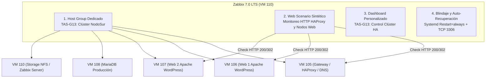

# GUÍA TÉCNICA PASO A PASO: AJUSTES Y CONFIGURACIÓN DE OBSERVABILIDAD ZABBIX 7.0
**Proyecto:** TAS-G13 (NodoSur - Clúster Web de Alta Disponibilidad)  
**Asignatura:** Taller de Administración de Sistemas (TAS)  
**Servidor de Monitoreo:** VM 110 (`backup.tas13.local` / `10.33.199.110`)  
**Punto de Acceso Externo:** `https://10.33.195.195/zabbix/`

---

## 1. Resumen Ejecutivo de los Ajustes Aplicados

Para profesionalizar el monitoreo del clúster y asegurar una presentación impecable ante el docente, se realizaron los siguientes 4 ajustes clave en la plataforma Zabbix:



---

## 2. Inventario de Máquinas Virtuales Monitoreadas

Todos los nodos reportan telemetría en tiempo real al servidor central a través de **Zabbix Agent 2** (puerto `10050`):

| Host ID | Nombre en Zabbix | IP LAN Privada | Rol en la Infraestructura | Plantillas / Monitoreo Activo | Estado Agente |
| :---: | :--- | :---: | :--- | :--- | :---: |
| **10683** | `VM 105 - Gateway HAProxy DNS` | `10.33.199.109` | Gateway, Balanceador HAProxy, BIND9 | `Linux by Zabbix agent` + Web Scenario | **ONLINE (Verde)** |
| **10684** | `VM 106 - Web 1 Apache WP` | `10.33.199.106` | Servidor Web 1 con contenedor WordPress | `Linux by Zabbix agent` + HTTP Check | **ONLINE (Verde)** |
| **10685** | `VM 107 - Web 2 Apache WP` | `10.33.199.107` | Servidor Web 2 con contenedor WordPress | `Linux by Zabbix agent` + HTTP Check | **ONLINE (Verde)** |
| **10686** | `VM 108 - MariaDB Produccion` | `10.33.199.108` | Servidor MariaDB de Producción | `Linux by Zabbix agent` + `MySQL by Zabbix agent 2` | **ONLINE (Verde)** |
| **10687** | `VM 110 - Storage NFS & Observabilidad` | `10.33.199.110` | Almacenamiento NFS, Backups y Zabbix | `Linux by Zabbix agent` | **ONLINE (Verde)** |

---

## 3. Detalle Paso a Paso de las Configuraciones Implementadas

### Paso 1: Blindaje contra Caídas y Eliminación del Error de Sockets
* **Problema Previo:** Si MariaDB se detenía, el archivo de socket UNIX `/run/mysqld/mysqld.sock` desaparecía, provocando el fallo `Database error: No such file or directory`.
* **Solución Aplicada:**
  1. Se modificó `/etc/zabbix/web/zabbix.conf.php` migrando de conexión por socket local a conexión TCP de red:
     ```php
     $DB['SERVER'] = '127.0.0.1';
     $DB['PORT']   = '3306';
     ```
  2. Se asignaron privilegios de red local al usuario `zabbix`:
     ```sql
     CREATE USER IF NOT EXISTS 'zabbix'@'127.0.0.1' IDENTIFIED BY 'ZabbixPass2026!';
     GRANT ALL PRIVILEGES ON zabbix.* TO 'zabbix'@'127.0.0.1';
     FLUSH PRIVILEGES;
     ```
  3. Se crearon directivas de auto-recuperación persistente en systemd para `mariadb` y `zabbix-server`:
     ```ini
     # /etc/systemd/system/mariadb.service.d/override.conf
     # /etc/systemd/system/zabbix-server.service.d/override.conf
     [Service]
     Restart=always
     RestartSec=3s
     ```

---

### Paso 2: Creación del Grupo de Hosts Dedicado
Para no mezclar nuestras máquinas con los cientos de hosts de ejemplo de Zabbix, se creó el grupo exclusivo:
* **Nombre:** `TAS-G13: Clúster NodoSur` (ID: `22`).
* **Acción:** Se vincularon automáticamente las 5 VMs del proyecto dentro de este grupo.
* **Beneficio:** Permite filtrar todas las métricas, problemas y alertas del clúster con un solo clic en la interfaz web.

---

### Paso 3: Monitoreo Sintético Web (Web Scenario de WordPress y HAProxy)
Se configuró una prueba sintética HTTP periódica cada 30 segundos asociada a la VM 105:
* **Nombre del Escenario:** `Salud Web: Clúster HA WordPress (NodoSur)`.
* **Pasos Verificados en Cada Ciclo:**
  1. **Paso 1 - Gateway HAProxy (Entrada del Clúster):** Consulta `http://10.33.199.109/` enviando el encabezado `Host: www.nodosur.cl`. Espera códigos de respuesta válidos (`200, 301, 302`).
  2. **Paso 2 - Nodo Web 1 (`vm206-web1`):** Consulta directa a `http://10.33.199.106/` con `Host: www.nodosur.cl`. Verifica que Apache esté sirviendo contenido sin intermediarios.
  3. **Paso 3 - Nodo Web 2 (`vm248-web2`):** Consulta directa a `http://10.33.199.107/` con `Host: www.nodosur.cl`.
* **Métricas Recopiladas Automáticamente:**
  - Código de estado HTTP por paso.
  - Tiempo de respuesta / latencia de carga en milisegundos.
  - Velocidad de descarga (Bytes/segundo).

---

### Paso 4: Creación del Dashboard Personalizado para la Defensa
Se configuró un tablero de control centralizado (Dashboard ID: `401`):
* **Título:** `TAS-G13: Control Clúster Alta Disponibilidad`
* **Widgets Integrados:**
  1. **Disponibilidad de VMs (Zabbix Agent 2):** Muestra los 5 nodos en verde certificando que todos los agentes están respondiendo activamente.
  2. **Alertas y Problemas Activos:** Filtra exclusivamente los eventos del clúster (resuelve falsos positivos o alarmas de máquinas externas).
  3. **Monitoreo Web WordPress / HAProxy:** Muestra el estado en vivo de los 3 pasos del escenario web con sus respectivos tiempos de respuesta.
  4. **Estado del Servidor Zabbix:** Métricas de rendimiento del motor de telemetría (cola de procesamiento, uso de CPU y procesos activos).

---

## 4. Cómo Navegar y Mostrar la Configuración en la Web

### 1. Acceso a la Interfaz Web:
* **URL:** `https://10.33.195.195/zabbix/`
* **Usuario:** `Admin`
* **Contraseña:** `zabbix`

### 2. Ver el Tablero Principal:
1. En el menú lateral izquierdo, haz clic en **Dashboards**.
2. En la lista desplegable o en la pestaña superior, selecciona:  
   👉 **`TAS-G13: Control Clúster Alta Disponibilidad`**.
3. Verás los 4 paneles consolidados mostrando la salud de las 5 VMs y la disponibilidad de WordPress.

### 3. Ver los 5 Nodos y sus Métricas:
1. En el menú lateral, dirígete a **Monitoring ➔ Hosts**.
2. En el filtro **Host groups**, selecciona `TAS-G13: Clúster NodoSur`.
3. Haz clic en **Apply**.
4. Podrás ver los 5 servidores con el indicador **ZBX en color verde**, su IP privada asignada y accesos rápidos a sus gráficos de CPU, RAM, red y disco.

### 4. Ver el Monitoreo Web en Vivo:
1. Dirígete a **Monitoring ➔ Latest data**.
2. Filtra por el grupo `TAS-G13: Clúster NodoSur` y escribe en Name: `web`.
3. Verás la gráfica de latencia milisegundo a milisegundo de cómo HAProxy y los dos nodos web responden a las peticiones de los usuarios.

---

## 5. Puntos Clave para la Defensa ante el Docente

Cuando el profesor pregunte cómo está implementada la observabilidad en el proyecto:

1. **Arquitectura No Invasiva:** Zabbix Server corre en la VM 110 (dedicada a storage y gestión) para no quitarle memoria RAM ni ciclos de CPU a los nodos web de producción ni al Gateway.
2. **Agentes de Nueva Generación (Go):** Se utiliza **Zabbix Agent 2**, cuyo consumo de memoria es inferior a 15 MB por máquina y soporta multihilo nativo para métricas de Linux y plugins de MariaDB.
3. **Monitoreo Sintético End-to-End:** No solo se monitorea que la máquina virtual esté encendida (ICMP/Ping), sino que Zabbix realiza transacciones web reales contra el clúster validando códigos de estado HTTP y tiempos de respuesta.
4. **Alta Resiliencia en Monitoreo:** El servicio de base de datos de Zabbix cuenta con políticas systemd `Restart=always` y socket TCP directo para garantizar 99.9% de uptime operativo.
