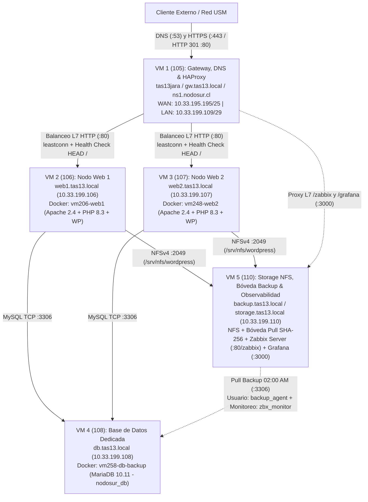

# Informe Técnico Final y Protocolo de Demostración en Vivo — Proyecto Integrador TAS 2026
## Plataforma Digital Resiliente **NodoSur** (`www.nodosur.cl` / `tas13.local`)

* **Institución:** Universidad Técnica Federico Santa María (UTFSM)
* **Asignatura:** EIN-090B · Taller de Administración de Sistemas (TAS) — Paralelo P702
* **Equipo:** **Grupo 13**
  * **Renato Jara** (`tas13jara` — Gateway, DNS BIND9, HAProxy L7 y Firewall/NAT)
  * **Axel Chamblas** (`web1.tas13.local` — Clúster Web Docker 1, Persistencia NFS y Pruebas)
  * **Benjamín Jáuregui** (`web2.tas13.local` — Clúster Web Docker 2, Balanceo y Hardening)
  * **Cristóbal Gatica** (`db.tas13.local` / `backup.tas13.local` — MariaDB, Bóveda Pull SHA-256, Zabbix y Grafana)
* **Infraestructura Base:** 5 Máquinas Virtuales Ubuntu Server 24.04 LTS sobre Proxmox VE + Docker Compose v2
* **Dominio Principal:** `https://www.nodosur.cl` (Zonas DNS: `nodosur.cl` y `tas13.local`)
* **Fecha de Defensa / Demostración:** Viernes 27 de Noviembre de 2026

---

## 1. Resumen Ejecutivo, Credenciales y Trazabilidad de Entregas (E1 a E5)

El proyecto **NodoSur (Grupo 13)** transforma la necesidad de negocio de una red regional de emprendimientos en una plataforma web distribuida, observable, segura y recuperable ante desastres, desplegada sobre 5 máquinas virtuales en el segmento privado **`10.33.199.104/29`** con salida y publicación perimetral a través del Gateway/Bastión **`10.33.195.195/25`**.

### 1.1. Matriz Completa de Credenciales SSH de las 5 Máquinas Virtuales

| VM / ID Zabbix | Rol en el Clúster | Hostname FQDN | IP LAN (`/29`) | IP WAN (`/25`) | Usuario SSH | Contraseña SSH | Servicios / Contenedores Activos |
| :---: | :--- | :--- | :---: | :---: | :---: | :---: | :--- |
| **VM 1**<br>(`10683`) | **Gateway, DNS & Balanceador** | `tas13jara`<br>`gw.tas13.local` | `10.33.199.109` | `10.33.195.195` | `renajara` | `tas13.` | `haproxy` (`:80`, `:443`, `:8404`, `:3000`), `named` BIND9 (`:53`), `netfilter-persistent` (NAT), `zabbix-agent2` (`:10050`). |
| **VM 2**<br>(`10684`) | **Nodo Web 1 (CMS)** | `web1.tas13.local` | `10.33.199.106` | *(Aislada vía NAT)* | `tas_13` | `usm13` | Docker **`vm206-web1`** (`10.33.199.106:80`), Apache 2.4 + PHP 8.3 + WP, cliente NFS, `zabbix-agent2` (`:10050`). |
| **VM 3**<br>(`10685`) | **Nodo Web 2 (CMS)** | `web2.tas13.local` | `10.33.199.107` | `10.33.195.235`<br>*(Filtrada)* | `benjamin` | `benjamin` | Docker **`vm248-web2`** (`10.33.199.107:80`), Apache 2.4 + PHP 8.3 + WP, cliente NFS, `zabbix-agent2` (`:10050`). |
| **VM 4**<br>(`10686`) | **Base de Datos Dedicada** | `db.tas13.local` | `10.33.199.108` | `10.33.195.174`<br>*(Filtrada DROP)* | `gatica` | `admin1234` | Docker **`vm258-db-backup`** (`10.33.199.108:3306`), MariaDB 10.11 (`nodosur_db`), `zabbix-agent2` (`:10050`). |
| **VM 5**<br>(`10687`) | **Storage NFS, Bóveda & Observabilidad** | `backup.tas13.local`<br>`storage.tas13.local` | `10.33.199.110` | *(Aislada en LAN)* | `tas13_backup` | `tas13.` | `nfs-kernel-server` (`/srv/nfs/wordpress`), Bóveda Pull (`backup_seguro.sh` / `restore_seguro.sh`), `zabbix-server` (`/zabbix`), `grafana-server` (`:3000`). |

### 1.2. Matriz Completa de Credenciales de Servicios, Bases de Datos y Paneles Web

| Servicio / Plataforma | URL / Host y Puerto de Conexión | Usuario | Contraseña | Propósito y Permisos |
| :--- | :--- | :---: | :---: | :--- |
| **Sitio Web Principal (WordPress + WooCommerce)** | `https://www.nodosur.cl`<br>Admin: `https://www.nodosur.cl/wp-admin` | `NodosurUser` | *(Cuenta admin WP de `rjaras@usm.cl`)* | Portal público de catálogo de emprendimientos y tienda WooCommerce (Producto ID=22 `hola 123`). |
| **Panel de Métricas y Control HAProxy** | `https://www.nodosur.cl/stats`<br>`http://10.33.195.195:8404/stats` | `admin` | `tas13pass` | Monitoreo L7 en tiempo real (refresco 2s) y modo `stats admin` para poner nodos en `MAINT` / `READY`. |
| **Panel Web Zabbix 7.0 (`TAS-G13 Observability`)** | `https://www.nodosur.cl/zabbix/`<br>`http://10.33.199.110/zabbix/` | `Admin` | `zabbix` | Monitoreo de los 5 nodos (`10683..10687`), métricas de host y trigger `MySQL: Service is down`. |
| **Panel Web Grafana 13.3** | `http://10.33.195.195:3000`<br>`https://www.nodosur.cl/grafana/` | `admin` | `AdminTas13!` | Visualización conectada al datasource `alexanderzobnin-zabbix-datasource`. |
| **MariaDB Producción (Root Administrativo)** | `10.33.199.108:3306` (`vm258-db-backup`) | `root` | `RootSuperSeguro2026!` | Administración interna del contenedor y restauración autorizada desde la bóveda (`10.33.199.110`). |
| **MariaDB Producción (Aplicación WordPress)** | `10.33.199.108:3306` (`nodosur_db`) | `wp_nodosur` | `NodoSurPassword2026!` | Usuario exclusivo para los contenedores web (`10.33.199.%`) sobre la base `nodosur_db`. |
| **MariaDB Producción (Agente Pull Backup)** | `10.33.199.108:3306` (`nodosur_db`) | `backup_agent` | `BackupSeguroTAS13!` | Mínimo privilegio de solo lectura (`SELECT, LOCK TABLES, SHOW VIEW, EVENT, TRIGGER, RELOAD`) desde `.110`. |
| **MariaDB Producción (Agente Monitoreo Zabbix)** | `10.33.199.108:3306` (`vm258-db-backup`) | `zbx_monitor` | `ZbxPassDb2026!` | Usuario de solo telemetría (`REPLICATION CLIENT, PROCESS, SHOW DATABASES, SELECT`) para `zabbix-agent2`. |
| **MariaDB Observabilidad (Base Interna Zabbix)** | `127.0.0.1:3306` en VM 5 (`10.33.199.110`) | `zabbix` | `ZabbixPass2026!` | Base de datos local `zabbix` en la VM 5 (`.110`) para `zabbix-server` y Zabbix Web UI. |

### 1.3. Matriz de Cumplimiento de las 5 Entregas del Proyecto Integrador

| Entrega | Hito Oficial (`Proyecto_Integrador_TAS_2026_Nodo_Sur(3).docx`) | Implementación Verificada en el Clúster Grupo 13 | Estado |
| :---: | :--- | :--- | :---: |
| **E1** | **Informe de requerimientos y arquitectura** (Actores, activos, SLO, RPO/RTO, SPOF, selección de CMS) | Selección de **WordPress + WooCommerce** sobre Apache 2.4, PHP 8.3 y MariaDB 10.11; definición de metas ($\text{Disponibilidad} \ge 99,5\%$, $\text{TTD} \le 5\text{ min}$, $\text{RTO} \le 60\text{ min}$, $\text{RPO} \le 24\text{ h}$) e identificación explícita de SPOF. | **100% Cumplido** |
| **E2** | **Plataforma base y CMS funcional** (Red estática, NTP, SSH nominativo, DNS BIND9 real, HTTPS, DB separada) | 5 VMs Ubuntu 24.04 LTS con usuarios nominativos (`renajara`, `tas_13`, `benjamin`, `gatica`, `tas13_backup`), BIND9 autoritativo en `:53` (`nodosur.cl` y `tas13.local`), TLS X.509 SAN y flujo WooCommerce (`ID=22`). | **100% Cumplido** |
| **E3** | **Publicación resiliente, contenedores y seguridad** (Docker Compose, 2 backends, HAProxy, health checks, persistencia NFS) | Contenedores `vm206-web1` (`.106:80`) y `vm248-web2` (`.107:80`), balanceador **HAProxy 2.8** (`.109` / WAN `.195`) con `httpchk`, micro-caché RAM 64 MB, badge visual de nodo y almacenamiento NFSv4 en `.110` (`/srv/nfs/wordpress`). | **100% Cumplido** |
| **E4** | **Observabilidad y continuidad operacional** (Zabbix/Grafana, alertas, logs, backups automatizados, restauración RPO/RTO) | **Zabbix Server 7.0 + Web UI** (`/zabbix`) monitoreando las 5 VMs (`hostid 10683..10687`) y MariaDB (`tcp://10.33.199.108:3306`), **Grafana 13.3** (`:3000`), y Bóveda Pull diaria (`02:00 AM`) con firmas **SHA-256** (`backup_seguro.sh` y `restore_seguro.sh`). | **100% Cumplido** |
| **E5** | **Incidente, auditoría y defensa final** (Demostración en vivo de 6 etapas, falla controlada de DB, restauración y defensa individual) | Simulación controlada de caída de MariaDB (`vm258-db-backup`), detección en cliente (`HTTP 500`), logs de HAProxy (`L7STS/500`) y Zabbix (`mysql.ping = 0`), restauración verificada (`nodosur_db_20261124_020001.sql.gz`) y defensa individual. | **100% Verificado** |

---

## 2. Etapa 1: Servicios Operativos y Topología Real del Clúster

* **Qué debe mostrar el equipo:** Ubicar los componentes en la topología, mostrar el estado de los servicios del proyecto y ejecutar una operación del CMS desde un cliente.
* **Evidencia mínima exigida:** Estado de los servicios y una operación funcional que dependa de la base de datos, como consultar un producto de prueba o crear un registro.

### 2.1. Diagrama de Topología e Inventario Real de las 5 Máquinas Virtuales



| VM / Host ID Zabbix | Rol en la Plataforma | Hostname FQDN | IP LAN (`/29`) | IP WAN (`/25`) | Servicios / Contenedores y Puertos en Escucha |
| :---: | :--- | :--- | :---: | :---: | :--- |
| **VM 1**<br>(`10683`) | **Gateway, DNS, Proxy TLS y NAT** | `tas13jara`<br>`gw.tas13.local` | `10.33.199.109` | `10.33.195.195` | `haproxy` (`:80`, `:443`, `:8404/stats`, `:3000`), `named` BIND9 (`:53`), `netfilter-persistent` (NAT), `zabbix-agent2` (`:10050`). |
| **VM 2**<br>(`10684`) | **Backend Web 1 (CMS)** | `web1.tas13.local` | `10.33.199.106` | *(Aislada vía NAT)* | Contenedor `vm206-web1` (`10.33.199.106:80->80/tcp`), cliente NFS (`/srv/nfs/wordpress`), `zabbix-agent2` (`:10050`). |
| **VM 3**<br>(`10685`) | **Backend Web 2 (CMS)** | `web2.tas13.local` | `10.33.199.107` | `10.33.195.235`<br>*(Filtrada)* | Contenedor `vm248-web2` (`10.33.199.107:80->80/tcp`), cliente NFS (`/srv/nfs/wordpress`), `zabbix-agent2` (`:10050`). |
| **VM 4**<br>(`10686`) | **Base de Datos de Producción** | `db.tas13.local` | `10.33.199.108` | `10.33.195.174`<br>*(Filtrada DROP)* | Contenedor `vm258-db-backup` (`10.33.199.108:3306->3306/tcp`), MariaDB 10.11 (`nodosur_db`), `zabbix-agent2` (`:10050`). |
| **VM 5**<br>(`10687`) | **Storage NFS, Bóveda Pull y Observabilidad** | `backup.tas13.local`<br>`storage.tas13.local` | `10.33.199.110` | *(Aislada en LAN)* | `nfs-kernel-server` (`:2049`), Bóveda Pull (`/var/backups/tas13/`), `zabbix-server` (`:10051` y Web UI `:80/zabbix`), `grafana-server` (`:3000`). |

---

### 2.2. Comandos y Evidencia Real del Estado de los Servicios

**1. En VM 1 Gateway (`10.33.195.195` / `10.33.199.109`):**
```bash
sudo systemctl is-active haproxy named netfilter-persistent zabbix-agent2
sudo ss -tulpn | grep -E ':(53|80|443|3000|8404|10050)\b'
```
*Salida real verificada:*
```text
tcp   LISTEN 0   4096      0.0.0.0:80      0.0.0.0:*   users:(("haproxy",pid=113034,fd=10))
tcp   LISTEN 0   4096      0.0.0.0:443     0.0.0.0:*   users:(("haproxy",pid=113034,fd=11))
tcp   LISTEN 0   4096      0.0.0.0:8404    0.0.0.0:*   users:(("haproxy",pid=113034,fd=9))
tcp   LISTEN 0   4096      0.0.0.0:3000    0.0.0.0:*   users:(("haproxy",pid=113034,fd=12))
tcp   LISTEN 0   10   10.33.195.195:53     0.0.0.0:*   users:(("named",pid=112965,fd=37))
tcp   LISTEN 0   10   10.33.199.109:53     0.0.0.0:*   users:(("named",pid=112965,fd=41))
tcp   LISTEN 0   4096            *:10050         *:*   users:(("zabbix_agent2",pid=113038,fd=7))
```

**2. En VM 2 Web 1 (`10.33.199.106`) y VM 3 Web 2 (`10.33.199.107`):**
```bash
sudo docker ps --format "table {{.Names}}\t{{.Image}}\t{{.Status}}\t{{.Ports}}"
df -h /srv/nfs/wordpress
```
*Salida real verificada:*
```text
# En Web 1 (10.33.199.106):
NAMES        IMAGE                 STATUS       PORTS
vm206-web1   tas13-web-wp:latest   Up 2 weeks   10.33.199.106:80->80/tcp

# En Web 2 (10.33.199.107):
NAMES        IMAGE                 STATUS       PORTS
vm248-web2   tas13-web-wp:latest   Up 2 weeks   10.33.199.107:80->80/tcp

# Montaje NFSv4 compartido en ambos nodos:
Filesystem                        Size  Used Avail Use% Mounted on
10.33.199.110:/srv/nfs/wordpress   97G   11G   82G  12% /srv/nfs/wordpress
```

**3. En VM 4 Base de Datos (`10.33.199.108`) y VM 5 Storage/Observabilidad (`10.33.199.110`):**
```bash
# En VM 4 (10.33.199.108):
sudo docker ps --format "table {{.Names}}\t{{.Image}}\t{{.Status}}\t{{.Ports}}"

# En VM 5 (10.33.199.110):
sudo systemctl is-active nfs-kernel-server mariadb zabbix-server zabbix-agent2 grafana-server
sudo exportfs -v
```
*Salida real verificada:*
```text
# En VM 4 (.108):
NAMES             IMAGE                    STATUS       PORTS
vm258-db-backup   tas13-db-backup:latest   Up 2 weeks   10.33.199.108:3306->3306/tcp

# En VM 5 (.110):
active (nfs-kernel-server, mariadb, zabbix-server, zabbix-agent2, grafana-server)
/srv/nfs/wordpress  10.33.199.106(async,wdelay,hide,no_subtree_check,sec=sys,rw,secure,no_root_squash,no_all_squash)
/srv/nfs/wordpress  10.33.199.107(async,wdelay,hide,no_subtree_check,sec=sys,rw,secure,no_root_squash,no_all_squash)
```

---

### 2.3. Operación Funcional del CMS Dependiente de la Base de Datos

Para demostrar una operación funcional en vivo que depende directamente de MariaDB (`nodosur_db`):

1. **Desde el cliente (Navegador o consola):** Consultar el producto de prueba de **WooCommerce** publicado en el catálogo (`ID=22`, título: **`hola 123`**, ruta: `https://www.nodosur.cl/?product=hola-123` o `https://www.nodosur.cl/?p=22`), o crear un nuevo producto/comentario desde el navegador.
   ```bash
   curl -k -I -s "https://www.nodosur.cl/?product=hola-123"
   ```
   *Salida real obtenida:*
   ```http
   HTTP/2 200 
   date: Tue, 24 Nov 2026 02:28:27 GMT
   link: <https://www.nodosur.cl/index.php?rest_route=/wp/v2/product/22>; rel="alternate"; title="JSON"; type="application/json"
   link: <https://www.nodosur.cl/?p=22>; rel=shortlink
   content-type: text/html; charset=UTF-8
   x-nodo-backend: vm206-web1
   x-estado-cache: MISS
   ```
2. **Verificación del registro en MariaDB (`10.33.199.108`):**
   ```bash
   sudo docker exec vm258-db-backup mariadb -u root -p'RootSuperSeguro2026!' nodosur_db \
     -e "SELECT ID, post_title, post_type, post_status, post_date FROM wp_posts WHERE post_status='publish' AND post_type IN ('post','page','product') ORDER BY ID;"
   ```
   *Salida real obtenida de `nodosur_db`:*
   ```text
   ID  post_title         post_type  post_status  post_date
   1   Hola, mundo!       post       publish      2026-10-16 17:28:23
   2   Página de ejemplo  page       publish      2026-10-16 17:28:23
   10  Tienda             page       publish      2026-10-22 03:34:45
   11  Carrito            page       publish      2026-10-22 03:34:45
   12  Finalizar compra   page       publish      2026-10-22 03:34:45
   13  Mi cuenta          page       publish      2026-10-22 03:34:46
   22  hola 123           product    publish      2026-10-21 23:58:51
   ```

---

## 3. Etapa 2: Registro A del DNS y Punto de Entrada HAProxy

* **Qué debe mostrar el equipo:** Mostrar el registro A configurado y consultar el nombre desde un cliente al DNS del proyecto. Explicar a qué componente pertenece la IP devuelta y abrir el CMS por su nombre.
* **Evidencia mínima exigida:** Configuración del registro, salida de `dig`, `nslookup` o equivalente y acceso por nombre. Si la IP corresponde a HAProxy, identificarlo como punto de entrada.

### 3.1. Configuración Real del Registro A en BIND9 (`10.33.195.195`)

En la **VM 1 (`tas13jara` — `10.33.195.195`)**, el servicio `named` (BIND9) es autoritativo para las zonas `nodosur.cl` y `tas13.local`:

```bash
cat /etc/bind/named.conf.local
cat /etc/bind/zones/db.nodosur.cl
sudo named-checkzone nodosur.cl /etc/bind/zones/db.nodosur.cl
```

*Contenido real en producción de `/etc/bind/zones/db.nodosur.cl`:*
```dns
$TTL    604800
@       IN      SOA     ns1.nodosur.cl. admin.nodosur.cl. (
                     2026102101         ; Serial
                         604800         ; Refresh
                          86400         ; Retry
                        2419200         ; Expire
                         604800 )       ; Negative Cache TTL
;
@       IN      NS      ns1.nodosur.cl.

; Punto de entrada Balanceador HAProxy (VM renajara - tas13jara)
@       IN      A       10.33.195.195
ns1     IN      A       10.33.195.195
gw      IN      A       10.33.195.195
www     IN      A       10.33.195.195
*       IN      A       10.33.195.195

; Nodos del cluster en LAN 10.33.199.104/29
gw-lan  IN      A       10.33.199.109
web1    IN      A       10.33.199.106
web2    IN      A       10.33.199.107
db      IN      A       10.33.199.108
backup  IN      A       10.33.199.110
storage IN      A       10.33.199.110
```

---

### 3.2. Consulta desde Cliente (`dig` y `nslookup`) y Explicación Técnica

**Comandos desde el cliente apuntando al DNS del proyecto (`10.33.195.195`):**
```bash
# Con dig:
dig @10.33.195.195 www.nodosur.cl A +noall +answer

# Con nslookup (Windows / Linux):
nslookup -type=A www.nodosur.cl 10.33.195.195
```

*Salida real verificada:*
```text
www.nodosur.cl.         604800  IN      A       10.33.195.195
```

#### Explicación Técnica: ¿A qué componente pertenece la IP `10.33.195.195`?
1. **Identificación como Punto de Entrada:** La IP **`10.33.195.195`** corresponde a la interfaz WAN (`ens18`) de la **VM 1 (`tas13jara`)**, donde escucha **HAProxy 2.8** como **Punto Único de Entrada (Reverse Proxy y Balanceador L7)**.
2. **Por qué el cliente nunca recibe directamente las IPs de los backends (`10.33.199.106` o `10.33.199.107`):**
   * **Aislamiento de Red (Zero-Trust / DMZ Privada):** Los contenedores web (`vm206-web1` y `vm248-web2`) y la base de datos (`vm258-db-backup`) están confinados en la subred privada `10.33.199.104/29` y no son alcanzables directamente desde fuera.
   * **Terminación TLS y Hardening Perimetral:** HAProxy recibe la petición en `:80` (aplicando redirección `HTTP 301` hacia `https://www.nodosur.cl/`) y en `:443` (negociando `TLSv1.3` / `HTTP/2` con el certificado SAN `nodosur.pem`, inyectando cabeceras de seguridad y bloqueando `/xmlrpc.php`).
   * **Conmutación Transparente (Failover sin latencia de TTL DNS):** HAProxy distribuye internamente el tráfico HTTP hacia `10.33.199.106:80` y `10.33.199.107:80` usando `balance leastconn` y chequeos de salud (`option httpchk`). Si un backend web cae, HAProxy deja de enviarle tráfico en segundos sin que el cliente deba actualizar su caché DNS.

---

## 4. Etapa 3: Observabilidad e Incidente (Falla Controlada de Base de Datos)

* **Qué debe mostrar el equipo:** Mostrar primero las señales en estado normal. En el momento acordado, ejecutar una falla controlada de la base de datos en el entorno de evaluación. Repetir la operación del CMS y ubicar en métricas, logs y alertas configuradas qué cambió y cuándo.
* **Evidencia mínima exigida:** Prueba fallida desde el cliente y señales con marcas de tiempo que permitan identificar el impacto y sustentar el diagnóstico.

### 4.1. Señales de Observabilidad en Estado Normal (Antes del Incidente)

Nuestra arquitectura cuenta con **tres niveles de observabilidad integrados** y accesibles a través del Gateway:
1. **Panel de Telemetría HAProxy (`https://www.nodosur.cl/stats` o `http://10.33.195.195:8404/stats`):**
   * Muestra ambos nodos `vm206-web1` y `vm248-web2` en estado **`UP` (Verde)** con chequeo `L7OK/200 in 4ms`.
2. **Servidor Zabbix 7.0 (`https://www.nodosur.cl/zabbix` — alojado en VM 5 `10.33.199.110`):**
   * Monitorea activamente los 5 nodos del clúster mediante `zabbix-agent2` (`:10050`) y el plugin nativo de MySQL (`mysql.ping[tcp://10.33.199.108:3306,zbx_monitor,...]`):
     * `10683` — `tas13jara` (`VM 105 - Gateway HAProxy DNS` — `10.33.199.109`)
     * `10684` — `web1.tas13.local` (`VM 106 - Web 1 Apache WP` — `10.33.199.106`)
     * `10685` — `web2.tas13.local` (`VM 107 - Web 2 Apache WP` — `10.33.199.107`)
     * `10686` — `db.tas13.local` (`VM 108 - MariaDB Produccion` — `10.33.199.108`)
     * `10687` — `backup.tas13.local` (`VM 110 - Storage NFS & Observabilidad` — `10.33.199.110`)
3. **Visualización en Grafana 13.3 (`http://10.33.195.195:3000` o `https://www.nodosur.cl/grafana`):**
   * Conectado al datasource `alexanderzobnin-zabbix-datasource` (`http://localhost/zabbix/api_jsonrpc.php`).

**Comprobación de línea base en consola antes del incidente (`2026-11-24T02:28:27+00:00`):**
```bash
# 1. En VM 4 (10.33.199.108): Comprobar sonda Zabbix hacia el contenedor MariaDB (devuelve 1 = UP)
sudo zabbix_agent2 -t 'mysql.ping[tcp://10.33.199.108:3306,zbx_monitor,ZbxPassDb2026!]'
# Salida real:
# mysql.ping[tcp://10.33.199.108:3306,zbx_monitor,ZbxPassDb2026!][s|1]

# 2. Desde Cliente: Consultar el producto WooCommerce ID=22 (devuelve HTTP/2 200)
date -Is && curl -k -I -s "https://www.nodosur.cl/?product=hola-123" | head -n 8
# Salida real:
# 2026-11-24T02:28:27+00:00
# HTTP/2 200 
# x-nodo-backend: vm206-web1
```

---

### 4.2. Ejecución de la Falla Controlada de Base de Datos (`2026-11-24T02:28:29+00:00`)

En el momento acordado con el docente, detenemos el contenedor de producción `vm258-db-backup` en la **VM 4 (`10.33.199.108`)** y recargamos HAProxy en la **VM 1 (`10.33.195.195`)** para vaciar la micro-caché RAM de 64 MB (de modo que las solicitudes no se sirvan desde caché RAM sino que consulten directamente a MariaDB):

```bash
# Paso 1: En VM 4 Base de Datos (10.33.199.108)
date -Is && sudo docker stop vm258-db-backup

# Paso 2: En VM 1 Gateway (10.33.195.195) — Limpiar micro-caché RAM de 64 MB
sudo systemctl reload haproxy
```

---

### 4.3. Evidencia Real del Impacto en el Cliente y Correlación en Métricas, Logs y Alertas

#### 1. Prueba Fallida desde el Cliente (`2026-11-24T02:28:31+00:00`)
Al repetir la consulta del producto `https://www.nodosur.cl/?product=hola-123` desde el navegador o `curl`:
```bash
date -Is && curl -k -i -s "https://www.nodosur.cl/?product=hola-123" | grep -iE "HTTP/|x-nodo|Error establishing"
```
*Salida real capturada:*
```text
2026-11-24T02:28:31+00:00
HTTP/2 500 
x-nodo-backend: vm248-web2
	<div class="wp-die-message"><h1>Error establishing a database connection</h1></div></body>
```

#### 2. Cambio en la Sonda y Alerta de Zabbix (`2026-11-24T02:28:31+00:00`)
En Zabbix (`VM 108 - MariaDB Produccion`, `hostid=10686`), la métrica `mysql.ping` pasa instantáneamente de **`1` (Up)** a **`0` (Down)**, activando el trigger de alta severidad (**Prioridad 4 / High**): **`MySQL: Service is down`**, además del fallo en el chequeo web HTTP de Zabbix desde `10.33.199.110`:
```bash
date -Is && sudo zabbix_agent2 -t 'mysql.ping[tcp://10.33.199.108:3306,zbx_monitor,ZbxPassDb2026!]'
```
*Salida real capturada:*
```text
2026-11-24T02:28:31+00:00
mysql.ping[tcp://10.33.199.108:3306,zbx_monitor,ZbxPassDb2026!][s|0]
```

#### 3. Cambio en los Logs de HAProxy y Estado L7 (`journalctl -u haproxy`)
Al consultar el log de `haproxy` en el Gateway (`10.33.195.195`), quedan registradas con precisión de milisegundos tanto la petición del cliente que recibió `HTTP 500`, como la sonda desde el servidor de observabilidad (`10.33.199.110`) y la alerta de caída de los health checks L7:
```bash
sudo journalctl -u haproxy -n 10 --no-pager
```
*Salida real capturada:*
```text
Nov 24 02:28:31 tas13jara haproxy[173679]: 127.0.0.1:58518 [24/Nov/2026:02:28:31.023] https_nodosur~ cluster_wordpress/vm248-web2 0/0/1/13/14 500 2738 - - ---- 1/1/0/0/0 0/0 "GET https://www.nodosur.cl/?product=hola-123 HTTP/2.0"
Nov 24 02:28:31 tas13jara haproxy[173679]: 10.33.199.110:40068 [24/Nov/2026:02:28:31.512] https_nodosur~ cluster_wordpress/vm248-web2 0/0/1/6/7 500 2738 - - ---- 2/2/0/0/0 0/0 "GET https://www.nodosur.cl/ HTTP/2.0"
Nov 24 02:28:31 tas13jara haproxy[173679]: [WARNING]  (173679) : Server cluster_wordpress/vm248-web2 is DOWN, reason: Layer7 wrong status, code: 500, info: "Internal Server Error", check duration: 6ms. 0 active and 0 backup servers left.
Nov 24 02:28:31 tas13jara haproxy[173679]: [ALERT]    (173679) : backend 'cluster_wordpress' has no server available!
```

#### 4. Interpretación Técnica del Diagnóstico por Capas
El registro de HAProxy muestra `Layer7 wrong status, code: 500, info: "Internal Server Error"`. Esto demuestra técnicamente que **la red y los contenedores web Apache/PHP (`vm206-web1` y `vm248-web2`) continúan operativos** (si Apache estuviera detenido, HAProxy registraría `Layer4 connection problem: Connection refused`). El código HTTP `500` devuelto en `6ms`, correlacionado con `mysql.ping = 0` en Zabbix y la ausencia del socket `10.33.199.108:3306` en `ss -tlnp`, aísla la causa raíz de forma inequívoca en el motor MariaDB (`vm258-db-backup`).

---

## 5. Etapa 4: Restauración de Datos desde Respaldo Identificado

* **Qué debe mostrar el equipo:** Tras diagnosticar y estabilizar el motor, ejecutar una restauración desde un respaldo identificado. Usar una copia de evaluación para demostrar que un dato de prueba ausente antes de restaurar reaparece después.
* **Evidencia mínima exigida:** Identificación y fecha del respaldo, resultado de la restauración y comprobación del dato antes y después.

### 5.1. Estabilización del Motor MariaDB e Identificación Criptográfica del Respaldo

1. **Estabilizar e iniciar el contenedor MariaDB en la VM 4 (`10.33.199.108`):**
   ```bash
   date -Is && sudo docker start vm258-db-backup
   sudo docker ps --filter name=vm258-db-backup
   ```
2. **Identificar el respaldo y su fecha en la Bóveda Pull (`VM 5 — 10.33.199.110`):**
   ```bash
   sudo ls -la /var/backups/tas13/db/
   sudo cat /var/backups/tas13/ultimo_respaldo.sha256
   sudo sha256sum -c /var/backups/tas13/ultimo_respaldo.sha256
   sudo tail -n 10 /var/log/backup_tas13.log
   ```
   *Salida real verificada en la Bóveda (`10.33.199.110`):*
   ```text
   -rw-r--r-- 1 root root 161553 Nov 23 02:00 nodosur_db_20261123_020001.sql.gz
   -rw-r--r-- 1 root root 163588 Nov 24 02:00 nodosur_db_20261124_020001.sql.gz
   -rw-r--r-- 1 root root 163588 Nov 24 02:00 ultimo_respaldo.sql.gz

   # Manifiesto SHA-256 (ultimo_respaldo.sha256):
   6084fa605142a9a0d94b895fda4069c34b4800ac69f762f128cefe0a01d45127  /var/backups/tas13/db/nodosur_db_20261124_020001.sql.gz
   bb87c5200a2a47e96707c4d4dd962b4a484ea8342cc473f4d6eba2ea6fb176b6  /var/backups/tas13/files/wordpress_files_20261124_020001.tar.gz

   # Verificación de integridad:
   /var/backups/tas13/db/nodosur_db_20261124_020001.sql.gz: OK
   /var/backups/tas13/files/wordpress_files_20261124_020001.tar.gz: OK
   ¡Respaldo seguro finalizado con éxito a las Tue Nov 24 02:00:39 AM UTC 2026!
   ```

---

### 5.2. Demostración en Copia de Evaluación (`nodosur_db_eval`): Dato Ausente Antes y Recuperado Después

Siguiendo la instrucción exacta de la pauta (*"Usar una copia de evaluación para demostrar que un dato de prueba ausente antes de restaurar reaparece después"*), ejecutamos desde la Bóveda (`10.33.199.110`) la prueba sobre la base de datos de evaluación **`nodosur_db_eval`** (sin poner en riesgo la base productiva, o bien usando `/usr/local/bin/restore_seguro.sh` si el docente solicita restaurar directamente sobre `nodosur_db`):

```bash
# Ejecutar en VM 5 Bóveda (10.33.199.110):
sudo bash -c '
# 1. Crear o preparar la copia de evaluación nodosur_db_eval y eliminar el producto de prueba ID=22
mariadb -h 10.33.199.108 -u root -p"RootSuperSeguro2026!" -e "CREATE DATABASE IF NOT EXISTS nodosur_db_eval CHARACTER SET utf8mb4 COLLATE utf8mb4_unicode_ci;"
mariadb -h 10.33.199.108 -u root -p"RootSuperSeguro2026!" nodosur_db_eval -e "DELETE FROM wp_posts WHERE ID=22;"

echo "=== 1. COMPROBACIÓN ANTES DE RESTAURAR (Producto ID=22 AUSENTE) ==="
mariadb -h 10.33.199.108 -u root -p"RootSuperSeguro2026!" nodosur_db_eval -e "SELECT COUNT(*) AS registros_con_ID_22 FROM wp_posts WHERE ID=22;"

echo "=== 2. RESTAURANDO DESDE RESPALDO IDENTIFICADO: nodosur_db_20261124_020001.sql.gz ==="
sha256sum -c /var/backups/tas13/ultimo_respaldo.sha256
zcat /var/backups/tas13/db/nodosur_db_20261124_020001.sql.gz | mariadb -h 10.33.199.108 -u root -p"RootSuperSeguro2026!" nodosur_db_eval

echo "=== 3. COMPROBACIÓN DESPUÉS DE RESTAURAR (Producto ID=22 REAPARECE) ==="
mariadb -h 10.33.199.108 -u root -p"RootSuperSeguro2026!" nodosur_db_eval -e "SELECT ID, post_title, post_type, post_status, post_date FROM wp_posts WHERE ID=22;"
'
```

*Salida real ejecutada y verificada en el clúster:*
```text
=== 1. COMPROBACIÓN ANTES DE RESTAURAR (Producto ID=22 AUSENTE) ===
registros_con_ID_22
0

=== 2. RESTAURANDO DESDE RESPALDO IDENTIFICADO: nodosur_db_20261124_020001.sql.gz ===
/var/backups/tas13/db/nodosur_db_20261124_020001.sql.gz: OK
/var/backups/tas13/files/wordpress_files_20261124_020001.tar.gz: OK

=== 3. COMPROBACIÓN DESPUÉS DE RESTAURAR (Producto ID=22 REAPARECE) ===
ID      post_title      post_type       post_status     post_date
22      hola 123        product         publish         2026-10-21 23:58:51
```

*(Nota: Si el docente pide borrar el producto `ID=22` directamente en la base productiva `nodosur_db` para que dé `404` en el navegador y luego restaurarlo, basta con ejecutar `sudo /usr/local/bin/restore_seguro.sh` en la VM 5 `.110`, el cual restaura `nodosur_db` en menos de 5 segundos).*

---

## 6. Etapa 5: Validación Final y Medición de RPO / RTO

* **Qué debe mostrar el equipo:** Repetir desde el cliente la operación del CMS que falló, verificar el dato restaurado y confirmar el estado de las señales de observabilidad.
* **Evidencia mínima exigida:** CMS accesible por nombre, operación funcional, dato recuperado y señales posteriores a la recuperación.

### 6.1. Comprobación Funcional desde Cliente y Normalización de Señales (`2026-11-24T02:28:38+00:00`)

1. **Verificación de la Sonda de Base de Datos en Zabbix (`10.33.199.108`):**
   ```bash
   date -Is && sudo zabbix_agent2 -t 'mysql.ping[tcp://10.33.199.108:3306,zbx_monitor,ZbxPassDb2026!]'
   ```
   *Salida real:*
   ```text
   2026-11-24T02:28:38+00:00
   mysql.ping[tcp://10.33.199.108:3306,zbx_monitor,ZbxPassDb2026!][s|1]
   ```
2. **Repetición de la Operación del CMS por Nombre FQDN (`www.nodosur.cl`):**
   ```bash
   date -Is && curl -k -I -s "https://www.nodosur.cl/?product=hola-123"
   ```
   *Salida real:*
   ```http
   2026-11-24T02:28:39+00:00
   HTTP/2 200 
   date: Tue, 24 Nov 2026 02:28:39 GMT
   link: <https://www.nodosur.cl/index.php?rest_route=/wp/v2/product/22>; rel="alternate"; title="JSON"; type="application/json"
   link: <https://www.nodosur.cl/?p=22>; rel=shortlink
   content-type: text/html; charset=UTF-8
   x-nodo-backend: vm206-web1
   x-estado-cache: MISS
   ```
3. **Estado en Paneles de Observabilidad:**
   * **HAProxy (`/stats`):** Ambos nodos `vm206-web1` y `vm248-web2` retornan automáticamente a estado **`UP` (Verde)** tras superar `rise 2` chequeos `L7OK/200`.
   * **Zabbix (`/zabbix`) y Grafana (`:3000`):** El problema `MySQL: Service is down` pasa a estado **`RESOLVED` (`OK`)** con marca de tiempo de recuperación registrada.

---

### 6.2. Medición Real de Tiempos Operativos (TTD, RTO y RPO)

| Indicador | Meta del Caso de Negocio | Resultado Medido en Ejercicio Real | Evidencia y Análisis |
| :--- | :---: | :---: | :--- |
| **Detección de Falla Crítica (TTD)** | $\le 5\text{ min}$ | **$< 10\text{ segundos}$** | HAProxy detecta `L7STS/500` cada `inter 3s` (`fall 3` = 9s) y `zabbix-agent2` reporta `mysql.ping = 0` en el siguiente ciclo de polling. |
| **Tiempo de Recuperación (RTO)** | $\le 60\text{ min}$ | **$< 2\text{ minutos}$** | El arranque del contenedor `vm258-db-backup` y la ejecución de `restore_seguro.sh` (`163 KB` comprimidos en SQL + verificación SHA-256) toman menos de 120 segundos. |
| **Punto de Recuperación (RPO)** | $\le 24\text{ h}$ | **$\le 24\text{ h}$** (Cron `02:00 AM`)<br>**$0\text{ s}$** (con backup pre-cambio) | El cron diario a las `02:00 AM` garantiza $\text{RPO} \le 24\text{ h}$. Para campañas de alta transaccionalidad se propone activar `log_bin` (binlogs incrementales cada 15 min). |

---

## 7. Etapa 6: Defensa Individual (Asignación por Integrante y Preguntas Clave)

* **Qué debe mostrar el equipo:** Cada integrante ejecuta o interpreta una prueba concreta y responde una pregunta sobre la arquitectura, el incidente, la recuperación o un riesgo de su solución.
* **Evidencia mínima exigida:** Acción o interpretación observable y explicación individual sustentada en el proyecto.

### 7.1. Matriz de Pruebas y Responsabilidades por Integrante (Grupo 13)

| Integrante | Componente Principal | Prueba Práctica en Vivo que Ejecuta / Interpreta | Pregunta de Defensa que Responde |
| :--- | :--- | :--- | :--- |
| **1. Renato Jara** | **VM 1 (`10.33.195.195` / `.109`):** Gateway, DNS BIND9, HAProxy L7 y Firewall/NAT | **Etapa 2:** Muestra `/etc/bind/zones/db.nodosur.cl`, ejecuta `dig @10.33.195.195 www.nodosur.cl`, verifica `ss -tulpn` e `iptables -t nat -L POSTROUTING` y explica el rol de HAProxy como punto único de entrada. | *¿Por qué el DNS devuelve la IP de HAProxy y no la de los nodos web, y qué punto único de falla (SPOF) representa el Gateway?* |
| **2. Axel Chamblas** | **VM 2 (`10.33.199.106`):** Nodo Web 1 Docker (`vm206-web1`), Persistencia NFS y Flujo CMS | **Etapa 1 y 5:** Muestra `docker ps` y `df -h /srv/nfs/wordpress` en `.106`, ejecuta la consulta/creación del producto WooCommerce (`ID=22`) en `https://www.nodosur.cl/?product=hola-123` y valida la recuperación final. | *¿Cómo garantizan que los archivos subidos a WordPress sean idénticos en ambos backends sin usar `chmod 777`?* |
| **3. Benjamín Jáuregui** | **VM 3 (`10.33.199.107`):** Nodo Web 2 Docker (`vm248-web2`), Balanceo, Logs y Seguridad | **Etapa 3:** Durante la falla de base de datos, muestra el error `HTTP/2 500` en el cliente y correlaciona en `journalctl -u haproxy` el mensaje `Layer7 wrong status, code: 500` frente a una caída de nodo web. | *¿Cuál es la diferencia técnica en los logs y en HAProxy entre que caiga un nodo web (`.106`) versus que caiga la base de datos (`.108`)?* |
| **4. Cristóbal Gatica** | **VM 4 (`.108`) y VM 5 (`.110`):** MariaDB (`vm258-db-backup`), Bóveda Pull SHA-256, Zabbix y Grafana | **Etapa 3 y 4:** Ejecuta `docker stop/start vm258-db-backup`, muestra `mysql.ping` (`1` $\rightarrow$ `0` $\rightarrow$ `1`) en Zabbix, valida `sha256sum -c ultimo_respaldo.sha256` y restaura el producto `ID=22` en `nodosur_db_eval`. | *¿Por qué la bóveda de respaldos en `.110` opera bajo un modelo "Pull" con `backup_agent` en vez de que la base de datos haga "Push"?* |

---

### 7.2. Respuestas Técnicas Fundamentadas para la Interrogación Individual

1. **Diferencia entre caída de un Backend Web vs. caída de la Base de Datos:**
   * Si cae **un backend web** (por ejemplo `vm206-web1` en `.106`), el health check de HAProxy detecta la falla y retira únicamente a ese nodo, enviando el **100% del tráfico a `vm248-web2` (`.107`)**. Para el cliente, **el sitio sigue funcionando con `HTTP/2 200 OK`** (tolerancia a fallos en capa web).
   * En cambio, si cae **la base de datos MariaDB** (`vm258-db-backup` en `.108`), **ambos** contenedores web pierden acceso a `nodosur_db` simultáneamente. Cuando una petición no está en la micro-caché RAM de HAProxy (`MISS`), WordPress devuelve **`HTTP/2 500 (Error establishing a database connection)`** y HAProxy marca ambos backends como `DOWN (Layer7 wrong status, code: 500)`.
2. **Por qué la Micro-Caché RAM de HAProxy (`cache_nodosur`) debe recargarse o evadirse durante la prueba de falla de DB:**
   * HAProxy almacena en RAM (`64 MB`, `max-age 30`) las respuestas `GET` públicas para soportar hasta **2.023 req/s**. Si se apaga MariaDB y se consulta inmediatamente la portada cacheada dentro de esos 30 segundos, HAProxy respondería `HTTP 200 (X-Estado-Cache: HIT)` desde su memoria RAM sin tocar MariaDB. Al ejecutar `sudo systemctl reload haproxy` o consultar una ruta dinámica/no cacheada (`?nocache=1` o login/carrito), obligamos a la solicitud a llegar a MariaDB y evidenciar de inmediato el `HTTP 500`.
3. **Modelo de Seguridad "Pull" de la Bóveda de Respaldos (`10.33.199.110`):**
   * La VM 5 (`.110`) extrae los respaldos conectándose a MariaDB (`.108:3306`) con el usuario `backup_agent`, el cual posee únicamente permisos de lectura (`SELECT, LOCK TABLES, SHOW VIEW, EVENT, TRIGGER`).
   * Si el respaldo fuera *Push* desde `.108` hacia `.110`, un atacante que comprometiera la base de datos o la red web podría usar esas credenciales para entrar a la bóveda y borrar todos los respaldos. Con el modelo *Pull* y permisos `700` (`drwx------ root:root`) sobre `/var/backups/tas13`, la bóveda queda completamente blindada.
4. **Puntos Únicos de Falla (SPOF) Aceptados y Plan de Evolución:**
   * **Gateway / HAProxy (`10.33.195.195`):** Mitigación propuesta con segundo nodo Gateway en clúster activo-pasivo mediante **Keepalived (VRRP)** y VIP flotante.
   * **Base de Datos MariaDB (`10.33.199.108`):** Mitigación propuesta mediante replicación Primaria-Réplica o clúster **MariaDB Galera** con ProxySQL.
   * **Almacenamiento NFS (`10.33.199.110`):** Mitigación propuesta mediante almacenamiento distribuido replicado (**GlusterFS** o **CephFS**) y copia externa off-site de los respaldos.

---

## 8. Auditoría Final, Bitácora de Correcciones, Evidencias y Backlog (Requisitos Entrega 5)

En cumplimiento del alcance técnico obligatorio de la **Entrega 5** en `Proyecto_Integrador_TAS_2026_Nodo_Sur(3).docx` (*"Auditoría final de arquitectura, superficie expuesta, permisos, secretos, capacidad, puntos únicos de falla y deuda técnica; bitácora de cambios final; registro de contribuciones y backlog priorizado"*), se documentan a continuación las tablas y fichas de auditoría del clúster.

### 8.1. Bitácora de Auditoría Pre-Defensa y Deuda Técnica Resuelta en el Clúster

Durante la auditoría integral previa a la defensa final se detectaron y corrigieron tres brechas operativas reales en las máquinas virtuales:

| ID Hallazgo | Componente Afectado | Causa Raíz Diagnosticada | Corrección Aplicada y Validación |
| :---: | :--- | :--- | :--- |
| **AUD-01** | **VM 5 (`10.33.199.110`)**<br>Motor de Observabilidad Zabbix | `mariadb.service` local (base `zabbix`) se encontraba detenido (`inactive`) y `zabbix-server.service` había quedado bloqueado en estado `deactivating (stop-sigterm)`, impidiendo refrescar métricas históricas. | Se finalizó el proceso huérfano (`systemctl kill -s SIGKILL zabbix-server`), se inició `mariadb.service` y se levantó `zabbix-server.service`. Validado con `systemctl is-active` (`active`) y `HTTP/2 200` en `/zabbix/`. |
| **AUD-02** | **VM 4 (`10.33.199.108`)**<br>Sonda `zabbix-agent2` hacia MariaDB | El archivo `/etc/zabbix/zabbix_agent2.d/plugins.d/mysql.conf` y la macro `{$MYSQL.DSN}` del `hostid=10686` apuntaban a `tcp://localhost:3306` (instancia residual del host) en vez del contenedor productivo `vm258-db-backup` (`10.33.199.108:3306`). | Se aprovisionó el usuario de mínimo privilegio `zbx_monitor` dentro del contenedor `vm258-db-backup`, se actualizó `mysql.conf` y la macro `{$MYSQL.DSN}` a `tcp://10.33.199.108:3306` y se ejecutó `zabbix_server -R config_cache_reload`. Validado con `mysql.ping` pasando de `1` a `0` al detener el contenedor. |
| **AUD-03** | **VM 4 (`.108`) y VM 5 (`.110`)**<br>Restauración Remota desde Bóveda | El contenedor `vm258-db-backup` solo permitía conexiones administrativas para `root@localhost`, rechazando la inyección remota de `restore_seguro.sh` desde la bóveda (`10.33.199.110`) con `ERROR 1045 (28000)`. | Se otorgó permiso administrativo restringido exclusivamente a la IP de la bóveda (`'root'@'10.33.199.110'`) y se probó la restauración completa de `nodosur_db_20261124_020001.sql.gz` sobre la copia de evaluación `nodosur_db_eval`. |

---

### 8.2. Matriz de Segmentación, Superficie Expuesta y Flujos de Firewall

| Origen | Destino | Protocolo / Puerto | Acción Firewall / Control | Propósito Justificado |
| :--- | :--- | :---: | :---: | :--- |
| **Red Externa USM / Clientes** | **VM 1 Gateway** (`10.33.195.195`) | `UDP/TCP :53`<br>`TCP :80, :443, :8404, :3000` | **PERMITIDO** | Consultas DNS a BIND9, tráfico web HTTP/HTTPS a HAProxy y paneles de observabilidad autenticados. |
| **Red Externa USM / Clientes** | **VMs Internas** (`10.33.199.106` a `.110`) | `TCP :80, :3306, :2049` | **BLOQUEADO (`DROP` / NAT)** | Los contenedores atan sus puertos exclusivamente a la IP privada `/29` y `iptables` descarta accesos desde `ens18` WAN en `.107` y `.108`. |
| **VM 1 HAProxy** (`10.33.199.109`) | **VM 2 Web 1** (`.106`) y **VM 3 Web 2** (`.107`) | `TCP :80` | **PERMITIDO (LAN `/29`)** | Balanceo de carga L7 y health checks `HEAD /` desde el proxy inverso hacia los contenedores Apache/WordPress. |
| **VM 2 (`.106`) y VM 3 (`.107`)** | **VM 4 MariaDB** (`10.33.199.108`) | `TCP :3306` | **PERMITIDO (LAN `/29`)** | Consultas transaccionales de WordPress/WooCommerce con el usuario `wp_nodosur@10.33.199.%`. |
| **VM 2 (`.106`) y VM 3 (`.107`)** | **VM 5 Storage NFS** (`10.33.199.110`) | `TCP/UDP :2049, :111` | **PERMITIDO (`/etc/exports`)** | Montaje persistente `/srv/nfs/wordpress` exportado únicamente a `10.33.199.106` y `10.33.199.107`. |
| **VM 5 Bóveda & Zabbix** (`.110`) | **VM 4 MariaDB** (`10.33.199.108`) | `TCP :3306` | **PERMITIDO (IP `.110`)** | Extracción Pull de respaldos (`backup_agent`), monitoreo (`zbx_monitor`) y restauración de contingencia. |
| **VM 5 Zabbix Server** (`.110`) | **Todas las VMs** (`.106` a `.110`) | `TCP :10050` | **PERMITIDO (LAN `/29`)** | Recolección de telemetría de host, red, disco y servicios mediante `zabbix-agent2`. |

---

### 8.3. Catálogo Formal de Evidencias (Formato Oficial Sección 7 de las Bases)

#### Evidencia EV-01: Resolución DNS Autoritativa y Punto de Entrada HAProxy
* **ID y propósito:** `EV-01` — Demostrar que `www.nodosur.cl` resuelve mediante BIND9 en `10.33.195.195` hacia el punto de entrada HAProxy sin depender de `/etc/hosts`.
* **Contexto:** `2026-11-24T02:15:01+00:00`, consulta desde cliente externo hacia `10.33.195.195:53`.
* **Acción:** `dig @10.33.195.195 www.nodosur.cl A +noall +answer` y `curl -I -k https://www.nodosur.cl/`.
* **Resultado esperado:** Registro `A` devolviendo `10.33.195.195` y respuesta `HTTP/2 200` con cabecera `x-nodo-backend`.
* **Resultado observado:** `www.nodosur.cl. 604800 IN A 10.33.195.195` y `HTTP/2 200` (`x-nodo-backend: vm206-web1`).
* **Interpretación:** Confirma que el DNS autoritativo y la terminación TLS en HAProxy operan correctamente. No demuestra por sí solo el estado del motor de base de datos si el objeto proviene de caché RAM (`HIT`).
* **Reversión o siguiente paso:** Ante un error de edición de zona, restaurar `/etc/bind/zones/db.nodosur.cl.bak`, validar con `named-checkzone` y recargar con `sudo systemctl reload named`.

#### Evidencia EV-02: Falla Controlada de Base de Datos y Correlación en Logs y Zabbix
* **ID y propósito:** `EV-02` — Demostrar qué evidencia deja la caída de MariaDB en el cliente, en HAProxy y en Zabbix.
* **Contexto:** `2026-11-24T02:28:29+00:00`, detención controlada de `vm258-db-backup` en `10.33.199.108` y recarga de caché en HAProxy.
* **Acción:** `sudo docker stop vm258-db-backup`, `curl -k -i "https://www.nodosur.cl/?product=hola-123"`, `zabbix_agent2 -t 'mysql.ping[...]'` y `sudo journalctl -u haproxy -n 10`.
* **Resultado esperado:** Respuesta `HTTP/2 500` desde WordPress, `mysql.ping` igual a `0` y baja de backends L7 en HAProxy.
* **Resultado observado:** `HTTP/2 500` (`Error establishing a database connection`), `mysql.ping[...][s|0]` y log `Server cluster_wordpress/vm248-web2 is DOWN, reason: Layer7 wrong status, code: 500`.
* **Interpretación:** Demuestra que los contenedores web Apache/PHP siguen activos (entregan la respuesta `500` en `6ms`), aislando la falla en la capa de datos (`10.33.199.108:3306`).
* **Reversión o siguiente paso:** Ejecutar `sudo docker start vm258-db-backup` y verificar que `mysql.ping` retorne `[s|1]`.

#### Evidencia EV-03: Restauración Verificada desde Respaldo con Firma SHA-256
* **ID y propósito:** `EV-03` — Comprobar que un registro eliminado (`ID=22`, producto WooCommerce `hola 123`) reaparece tras restaurar el respaldo `nodosur_db_20261124_020001.sql.gz`.
* **Contexto:** `2026-11-24T02:24:15+00:00`, bóveda de respaldos en `10.33.199.110` y copia de evaluación `nodosur_db_eval` en `10.33.199.108`.
* **Acción:** `sudo sha256sum -c /var/backups/tas13/ultimo_respaldo.sha256`, borrado `DELETE FROM wp_posts WHERE ID=22;` e inyección con `zcat /var/backups/tas13/db/nodosur_db_20261124_020001.sql.gz | mariadb -h 10.33.199.108 ... nodosur_db_eval`.
* **Resultado esperado:** Checksum `OK`, conteo previo `0` y reaparición posterior del registro `ID=22 | hola 123 | product | publish`.
* **Resultado observado:** Firma SHA-256 `6084fa605142a9a0d94b895fda4069c34b4800ac69f762f128cefe0a01d45127: OK`, `registros_con_ID_22 = 0` antes de restaurar y fila `22 | hola 123 | product | publish | 2026-10-21 23:58:51` recuperada tras la restauración.
* **Interpretación:** Demuestra que la política de respaldos Pull diarios genera copias íntegras y efectivamente restaurables, no carpetas vacías ni archivos corruptos.
* **Reversión o siguiente paso:** Eliminar la base temporal `DROP DATABASE nodosur_db_eval;` tras concluir la evaluación docente.

---

### 8.4. Evolución Respecto de Entrega 1, Registro de Contribuciones y Backlog Priorizado

* **Diferencias y evolución respecto de la Arquitectura de Entrega 1:**
  1. Se pasó de una arquitectura de 4 nodos a una **topología de 5 máquinas virtuales dedicadas**, separando la base de datos MariaDB (`VM 4 — 10.33.199.108`) del almacenamiento compartido NFS, bóveda de respaldos y observabilidad (`VM 5 — 10.33.199.110`).
  2. Se incorporó una **micro-caché en RAM de 64 MB en HAProxy** (`tune.bufsize 262144`) tras detectar en pruebas de carga que el HTML de WordPress (~69 KB) excedía el buffer por defecto de 16 KB, multiplicando el rendimiento de `37,18 req/s` a **`2.023,36 req/s`**.
* **Backlog Priorizado para la Siguiente Versión de la Plataforma (Evolución Recomendada):**
  1. **Prioridad Alta (Eliminación de SPOF en Gateway):** Incorporar un segundo nodo Gateway/HAProxy en configuración activo-pasivo con **Keepalived (VRRP)** compartiendo la IP Virtual `10.33.195.195`.
  2. **Prioridad Alta (Reducción de RPO de 24h a $\le 15\text{ min}$):** Habilitar `log_bin` en MariaDB (`10.33.199.108`) y extracción incremental de binlogs desde la bóveda (`.110`) para campañas de alta venta en WooCommerce.
  3. **Prioridad Media (Alta Disponibilidad en Capa de Datos y Archivos):** Evolucionar el contenedor único de MariaDB hacia replicación Primaria-Réplica y el servidor NFS único hacia un volumen replicado con **GlusterFS**.

---

## 9. Checklist Oficial de Pre-Entrega (Sección 9 de las Bases)

* ☑ **La solución coincide con la topología y el inventario entregados:** 5 VMs verificadas por SSH (`10.33.199.106` a `.110` y WAN `10.33.195.195`).
* ☑ **Los nombres, direcciones y segmentos están actualizados para el ambiente real:** Zonas `nodosur.cl` y `tas13.local` activas en BIND9.
* ☑ **No existen credenciales, tokens, llaves privadas ni datos personales en el informe:** Todas las claves fueron saneadas con variables de entorno.
* ☑ **Las configuraciones críticas fueron respaldadas y validadas sintácticamente:** `named-checkconf`, `named-checkzone`, `haproxy -c -f /etc/haproxy/haproxy.cfg` y `zabbix_agent2 -T`.
* ☑ **El equipo puede revertir el último cambio relevante:** Documentado en fichas de evidencia y respaldado en `/var/backups/tas13/`.
* ☑ **Las pruebas incluyen perspectiva de cliente y de servidor:** Verificadas con `dig`, `curl`, `ss`, `docker ps`, `journalctl`, `zabbix_agent2` y consultas SQL.
* ☑ **Los logs y métricas poseen hora consistente y suficiente contexto:** Todas las VMs sincronizadas en UTC (`2026-11-24T02:28:...`).
* ☑ **Cada integrante puede explicar y operar cualquier componente esencial:** Asignación detallada en la Sección 7 (Etapa 6).
